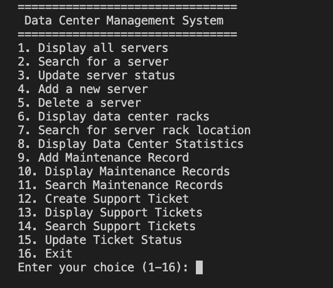
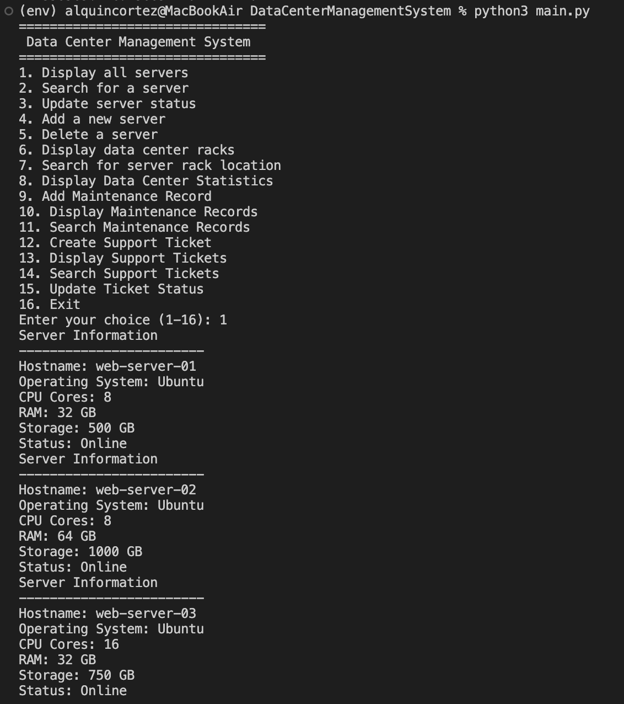
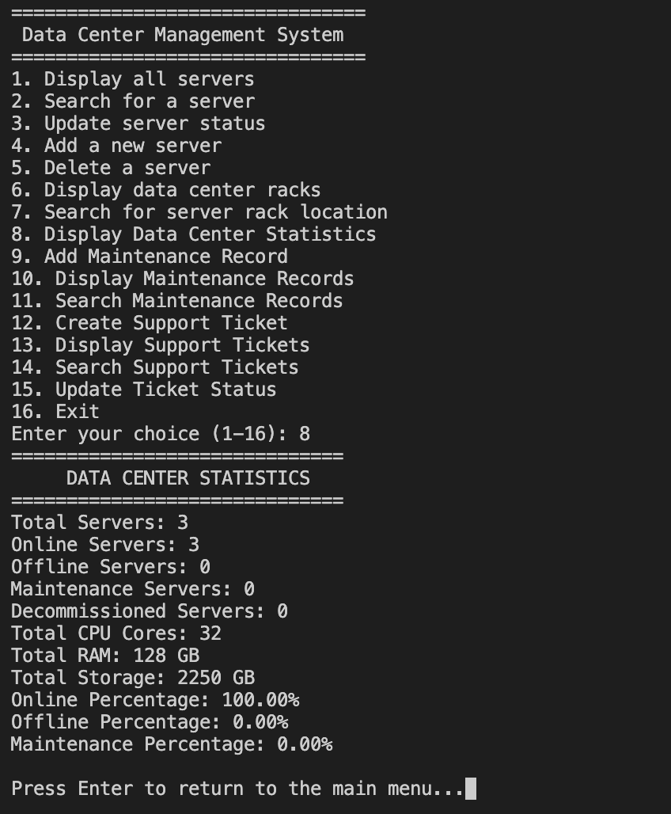

# 🖥️ Data Center Management System

<div align="center">

**A Python-based application for simulating data center operations**

Managing server inventory, rack organization, maintenance records, and IT support tickets.


</div>

---

## 📑 Table of Contents

- [Overview](#-overview)
- [Features](#-features)
- [Technologies Used](#-technologies-used)
- [Project Structure](#-project-structure)
- [Getting Started](#-getting-started)
- [Application Menu](#-application-menu)
- [What I Learned](#-what-i-learned)
- [Future Improvements](#-future-improvements)
- [Notes](#-notes)

---

## 📌 Overview

The **Data Center Management System** is a command-line application designed to simulate basic data center operations.

Users can manage server inventory, organize servers into rack positions, monitor hardware statistics, document maintenance activities, and track IT support tickets.

This project was built as a hands-on opportunity to practice Python programming, object-oriented programming, and infrastructure management concepts.

---

## ✨ Features

| Feature | Description |
|:---|:---|
| 🖥️ **Server Inventory** | Add, delete, search, display, and update server information. |
| 🗄️ **Rack Management** | Organize servers into racks and search for their physical positions. |
| 📊 **Data Center Statistics** | Track server status, CPU cores, RAM, and storage. |
| 🔧 **Maintenance Records** | Create, display, and search server maintenance records. |
| 🎫 **Support Tickets** | Create, search, display, and update support ticket statuses. |

---

## 📸 Application Preview

### Main Menu


### Server Inventory


### Data Center Statistics


---

## 🛠️ Technologies Used

<p align="center">


</p>

- Object-Oriented Programming (OOP)
- Classes and Objects
- Lists and Dictionaries
- Two-Dimensional Lists
- Functions and Modules
- Loops and Conditional Statements

---

## 📂 Project Structure

```text
DataCenterManagementSystem/
│
├── main.py          # Main application and menu
├── Server.py       # Server class and attributes
├── Rack.py         # Rack organization and management
├── Statistics.py   # Data center statistics
├── Maintenance.py  # Maintenance record management
├── Ticket.py       # IT support ticket management
│
└── README.md
```

---

## 🚀 Getting Started

### 1. Clone the repository

```bash
git clone https://github.com/Owlquin/Data-Center-Management_System.git
```

### 2. Navigate to the project directory

```bash
cd Data-Center-Management_System
```

### 3. Run the application

```bash
python3 main.py
```

---

## 💻 Application Menu

The application provides a menu-driven interface for accessing its features:

- Display all servers
- Search for a server
- Update server status
- Add or delete servers
- Display data center racks
- Search for server rack locations
- Display data center statistics
- Add and search maintenance records
- Create and manage IT support tickets

---

## 📚 What I Learned

Through this project, I practiced:

- Designing Python classes and using encapsulation.
- Organizing code into multiple modules.
- Working with lists, dictionaries, and multidimensional lists.
- Passing data between functions and modules.
- Building menu-driven applications.
- Managing server inventory and simulating common data center operations.

---

## 🔮 Future Improvements

- Add persistent data storage using SQLite.
- Implement input validation and error handling.
- Add server filtering and additional reporting.
- Develop a graphical user interface.
- Expand server monitoring capabilities.

---

## 📝 Notes

This project currently stores application data in memory. Server inventory, maintenance records, and support tickets are not saved after the application exits.

---

<div align="center">

**Developed by Alquin**

</div>